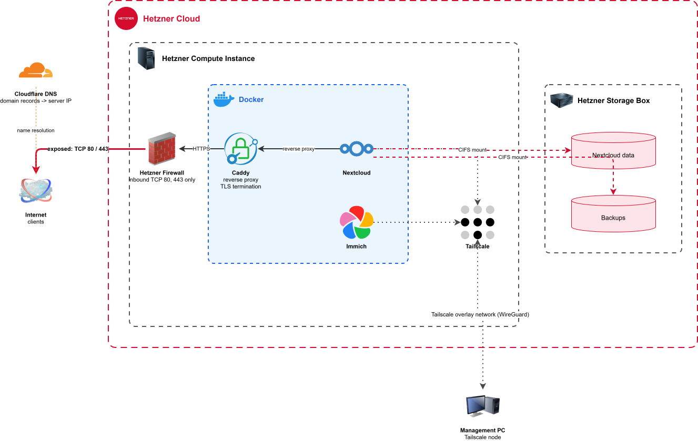

# PrivateCloud
The setup runs on a single Hetzner Cloud compute instance. Nextcloud and Immich run as Docker containers on it. Caddy, also in Docker, is the reverse proxy for Nextcloud and terminates TLS. The Hetzner Firewall only lets in TCP 80 and 443, so Nextcloud is the only service published to the Internet. Cloudflare manages the DNS records that point to the server.

Nextcloud’s data and backups live on a Hetzner Storage Box, attached to the server through CIFS mounts. This keeps storage separate from the compute instance. Tailscale runs on the host and puts Nextcloud and Immich on a private overlay network. Administration is done from a management PC on that same network, without opening any extra public ports.

